# Aura Makeup - Con IA

**Laboratorio 11-12 - Programación en Móviles - TECSUP**


**Integrante:** Magaly Rosales Porras

## Tema y variante

| Tema | API | Variante |
|---|---|---|
| Productos (belleza) | [DummyJSON](https://dummyjson.com) | Categorías `beauty`, `skin-care`, `fragrances` |

| Uso | Endpoint |
|---|---|
| Lista | `GET products/category/{slug}` |
| Detalle | `GET products/{id}` |

## Estructura del proyecto

```
com.tecsup.auramakeup
├── MainActivity.kt
├── AuraApp.kt
├── AppContainer.kt
├── data/
│   ├── auth/         AuthRepository, FirebaseAuthRepository
│   ├── local/        ProductoEntity, ProductoDao, CarritoEntity, CarritoDao, AppDatabase
│   ├── mapper/       Mappers
│   ├── network/      MonitorConexion, MonitorConexionAndroid
│   ├── perfil/       PerfilRepository, PerfilRepositoryAndroid
│   ├── remote/       ApiService, RetrofitClient, dto/ProductoDto
│   └── repository/   ItemRepository, ItemRepositoryImpl, CarritoRepository, CarritoRepositoryImpl
├── domain/model/     Item, ItemCarrito, Sesion
├── notification/     Notificador, NotificadorAndroid
└── ui/
    ├── UiState.kt
    ├── navigation/   AppNav, SesionViewModel
    ├── login/        LoginScreen, LoginViewModel
    ├── registro/     RegistroScreen, RegistroViewModel
    ├── lista/        ListaScreen, ListaViewModel
    ├── detalle/      DetalleScreen, DetalleViewModel
    ├── favoritos/    FavoritosScreen, FavoritosViewModel
    ├── carrito/      CarritoScreen, CarritoViewModel
    ├── pago/         PagoScreen, PagoViewModel
    ├── perfil/       PerfilScreen, PerfilViewModel
    ├── admin/        AdminScreen, AdminViewModel
    ├── components/   Cargando, ErrorView, ProductoCard, Categorias
    └── theme/        Color, Theme, Type
```


## Funcionalidades

| Función | Cliente | Admin |
|---|---|---|
| Iniciar sesión | Sí | Sí |
| Registrarse desde la app | Sí | No |
| Ver lista, detalle y filtro por categorías | Sí | Sí |
| Favoritos | Sí | Sí |
| Modo sin conexión | Sí | Sí |
| Perfil con foto y cerrar sesión | Sí | Sí |
| Carrito con contador | Sí | No |
| Pago simulado | Sí | No |
| Panel Admin (totales, sincronizar, limpiar caché) | No | Sí |

## Capturas

### Cliente

| Login | Registro | Lista |
|---|---|---|
| 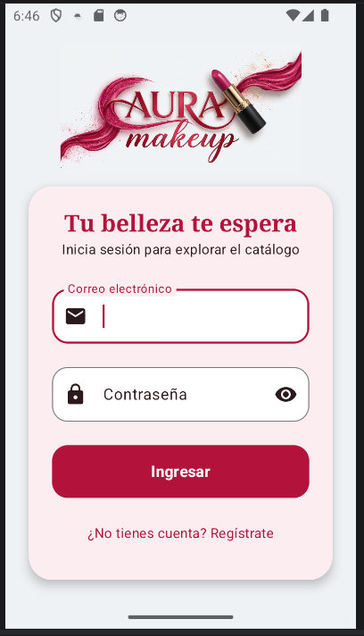 | 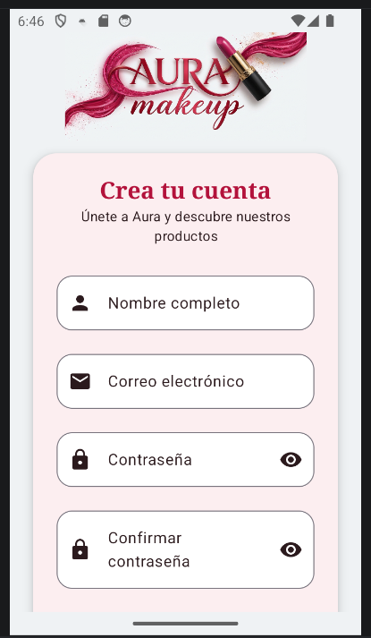 | 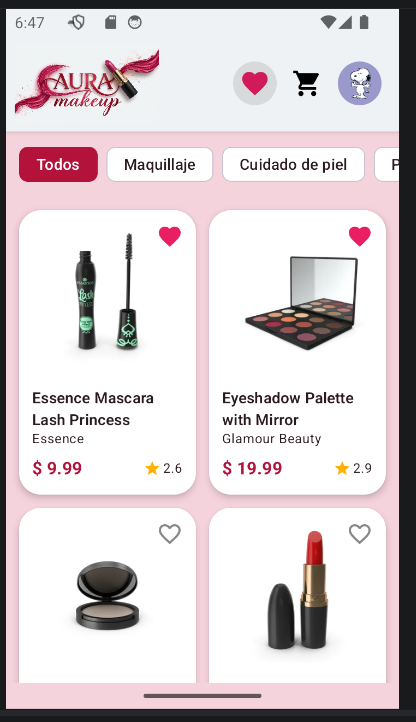 |

| Detalle | Favoritos | Perfil |
|---|---|---|
| 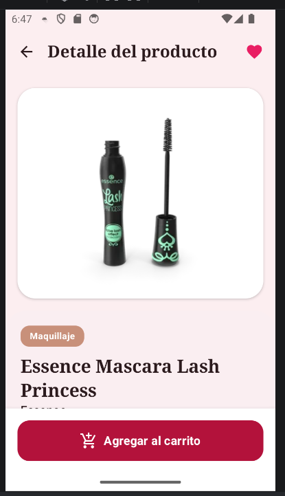 | 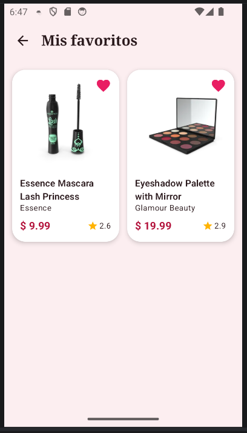 | 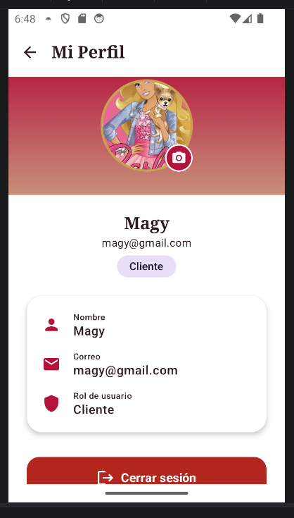 |

### Administrador

| Lista | Panel Admin | Limpiar caché |
|---|---|---|
| 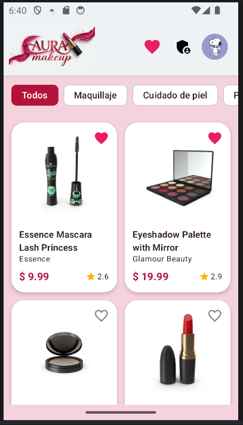 | 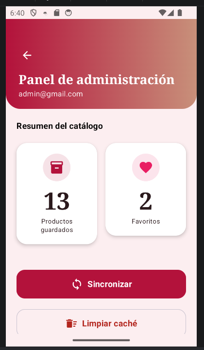 | 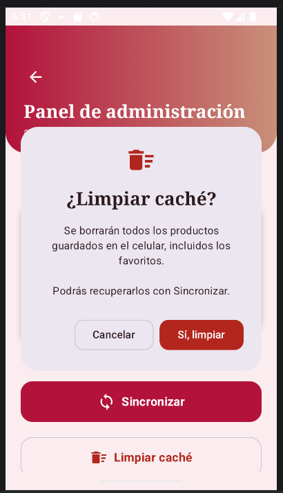 |

| Detalle | Perfil |
|---|---|
| 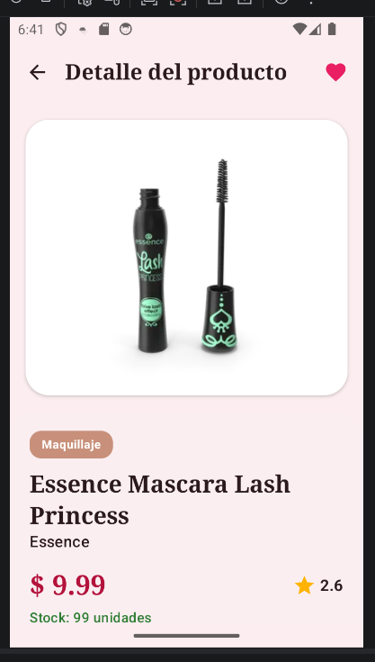 | 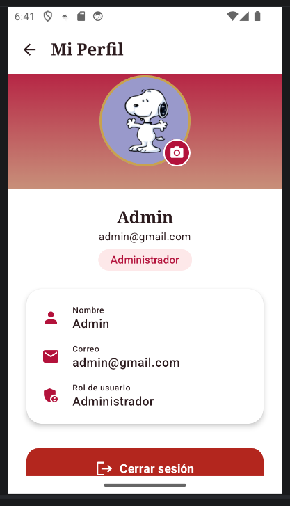 |

## Reparto de tareas

| Integrante | Tareas |
|---|---|
| Magaly Rosales | Todo el proyecto: estructura MVVM, Retrofit, Room, Firebase, panel Admin, notificaciones, pruebas unitarias, mejoras con IA y documentación |

## Mejoras con IA

| Etapa | Mejora |
|---|---|
| 1 | Tema visual de marca con los colores del logo y login rediseñado |
| 2 | Registro de clientes con Firebase Auth y Firestore |
| 3 | Perfil con foto guardada en el celular y cierre de sesión con confirmación |
| 4 | Carrito con contador, acceso solo para clientes y confirmación al eliminar |
| 5 | Pago simulado con tarjeta interactiva y notificación de pedido |
| 6 | Rediseño del panel Admin, la lista (filtro por categorías) y el detalle |

### Prompt utilizado

```
Actúa como desarrollador Android senior y diseñador UI. Vas a trabajar sobre mi proyecto Android ya existente "Aura Makeup", ubicado en la carpeta semana12. Es un laboratorio académico de Programación en Móviles (TECSUP). Antes de escribir código, lee y analiza los archivos actuales del proyecto para respetar lo que ya existe.

CONTEXTO DEL PROYECTO
- Paquete: com.tecsup.auramakeup
- Kotlin + Jetpack Compose + Material 3, sin XML.
- App de catálogo de maquillaje que consume DummyJSON (categorías beauty, skin-care y fragrances).
- Arquitectura MVVM obligatoria: cada pantalla tiene su Screen (Composable) y su ViewModel que expone StateFlow<UiState<T>> (UiState está en ui/UiState.kt con Cargando, Exito y Error).
- Los ViewModel se crean con un companion object factory(container: AppContainer) usando viewModelFactory { initializer { ... } }.
- AppContainer.kt crea la base de datos Room, los repositorios, el notificador, el monitor de conexión y el AuthRepository.
- Room es la fuente única de verdad. Base de datos: data/local/AppDatabase.kt.
- Los ViewModel dependen siempre de interfaces (ItemRepository, AuthRepository), nunca de la clase concreta.
- Modelos de UI en domain/model (Item, Sesion, Rol). Entidades de Room en data/local. Mappers en data/mapper/Mappers.kt.
- Login con Firebase Authentication. El rol se lee de Firestore en usuarios/{uid} con los campos rol ("admin" o "usuario") y nombre. Está en data/auth/FirebaseAuthRepository.kt.
- Navegación en ui/navigation/AppNav.kt, con SesionViewModel. Ahí ya existe la variable esAdmin (true si el rol es ADMIN). El cierre de sesión actual llama a sesionVm.cerrarSesion() y navega al login limpiando la pila.
- Notificaciones locales con la interface Notificador y su implementación NotificadorAndroid.
- Pantallas existentes: login, lista, detalle, favoritos y admin. Componentes en ui/components (Cargando, ErrorView, ProductoCard, Categorias).
- Ya existen pruebas unitarias en app/src/test/.../ui/lista/ListaViewModelTest.kt y fakes en app/src/test/.../fakes/Fakes.kt.
- El logo de la app ya está en res/drawable/logo_aura.png. Es una imagen horizontal con fondo claro, la palabra AURA en rojo carmesí y oro rosa, "makeup" en letra cursiva oro rosa y un labial rojo con dorado.

REGLAS OBLIGATORIAS
1. No uses Retrofit, Room ni Firebase dentro de un Composable. Las pantallas solo observan el estado con collectAsStateWithLifecycle() y llaman funciones del ViewModel.
2. El ViewModel no recibe Context ni importa clases de vista.
3. No cambies el constructor de ListaViewModel, para no romper las pruebas existentes. Al terminar cada etapa, las pruebas de ListaViewModelTest deben seguir pasando.
4. No cambies los nombres de los métodos que ya existen en AuthRepository ni en ItemRepository. Sí puedes agregar métodos nuevos.
5. No modifiques ni crees el archivo google-services.json.
6. No escribas comentarios en el código.
7. No uses emojis en ningún lugar: ni en el código, ni en los textos de la interfaz, ni en los mensajes. Si encuentras emojis en textos existentes, quítalos.
8. Nombres de clases, funciones y variables en español, siguiendo el estilo del proyecto.
9. No ejecutes comandos de git. Yo hago los commits.
10. Entrega siempre archivos completos y compilables, con todos sus imports.
11. No uses Firebase Storage (requiere plan de pago).

FORMA DE TRABAJO
El trabajo está dividido en 6 etapas. Haz SOLO una etapa a la vez. Al terminar cada etapa:
- Verifica que el proyecto compila.
- Detente y muéstrame: la lista de archivos creados o modificados, cómo probarlo en el emulador y el mensaje de commit sugerido en formato "tipo: descripción en español".
- No continúes con la siguiente etapa hasta que yo te escriba "continúa".

ETAPA 1: TEMA VISUAL Y REDISEÑO DEL LOGIN CON LOGO
- Crea una paleta inspirada en el logo y aplícala en ui/theme (Color.kt y Theme.kt):
  - Primario: rojo carmesí (aprox. #B3123B).
  - Secundario: oro rosa (aprox. #C8907A).
  - Terciario: dorado (aprox. #C9A24D).
  - Fondo: blanco crema (aprox. #FFF8F6). Superficies blancas.
  - Texto oscuro cálido (aprox. #2B1A1D).
  - Define también la versión de modo oscuro con los mismos tonos.
- Desactiva el color dinámico (dynamicColor = false) para que siempre se use la paleta de la marca.
- En Type.kt usa FontFamily.Serif para los títulos grandes (display, headline y titleLarge) para dar un estilo elegante. El resto con la fuente por defecto.
- Rediseña la pantalla de login:
  - El logo res/drawable/logo_aura.png va arriba, centrado y ocupando casi todo el ancho, con ContentScale.Fit.
  - Debajo, un texto de bienvenida y el formulario dentro de una Card con esquinas redondeadas de 24dp y una sombra suave.
  - Campos con esquinas redondeadas de 16dp e íconos.
  - Botón "Ingresar" con esquinas redondeadas de 16dp y altura de 54dp.
  - Fondo con un degradado vertical suave de blanco crema a un rosado muy claro.
  - Agrega un texto clickeable "¿No tienes cuenta? Regístrate" debajo del botón (en esta etapa solo déjalo preparado con un parámetro onIrARegistro; se conecta en la etapa 2).
- Mantén toda la lógica actual del LoginViewModel (validación de campos vacíos y mensajes de error).

ETAPA 2: REGISTRO DE CLIENTES
- Solo se pueden registrar clientes (rol "usuario"). El administrador es único y se crea en la consola de Firebase.
- En la interface AuthRepository agrega el método: suspend fun registrar(nombre: String, correo: String, clave: String): Result<Sesion>
- En FirebaseAuthRepository implementa registrar: crea la cuenta con createUserWithEmailAndPassword y luego crea el documento usuarios/{uid} con rol = "usuario" y nombre. Devuelve la Sesion con Rol.USUARIO.
- Traduce los errores de Firebase a mensajes en español dentro del repositorio: correo ya registrado, correo con formato inválido, contraseña débil (menos de 6 caracteres) y sin conexión.
- Crea ui/registro/RegistroViewModel.kt y ui/registro/RegistroScreen.kt con los campos: nombre, correo, contraseña y confirmar contraseña.
- Validaciones en el ViewModel antes de llamar a Firebase: campos vacíos, formato de correo, contraseña de mínimo 6 caracteres y que las contraseñas coincidan.
- Mismo estilo visual que el login (logo arriba, Card, degradado).
- Al registrarse con éxito, entra directo a la lista como cliente usando SesionViewModel.establecer.
- Agrega la ruta "registro" en AppNav y conecta el texto "¿No tienes cuenta? Regístrate" del login.
- Al terminar, muéstrame las nuevas reglas de Firestore que debo publicar en la consola. Deben permitir que cada usuario lea solo su documento y que cree su propio documento solo con rol "usuario" y solo con los campos rol y nombre. Nadie puede actualizar ni borrar.

ETAPA 3: PERFIL DE USUARIO (ADMIN Y CLIENTE)
- Agrega el campo nombre a la clase Sesion con valor por defecto "" (data class Sesion(val uid: String, val correo: String, val rol: Rol, val nombre: String = "")), para no romper el código existente. En FirebaseAuthRepository lee el campo nombre del documento de Firestore y llénalo en la Sesion.
- La pantalla de perfil está disponible para ambos roles (admin y cliente).
- Foto de perfil guardada solo en el celular (no en la nube):
  - Crea la interface data/perfil/PerfilRepository.kt con: fun foto(uid: String): Flow<String?> y suspend fun guardarFoto(uid: String, uri: String): Result<Unit>.
  - Crea data/perfil/PerfilRepositoryAndroid.kt que recibe Context: copia la imagen elegida a la memoria interna de la app (filesDir) con el nombre perfil_{uid}.jpg y guarda la ruta en SharedPreferences por uid. La foto debe conservarse al cerrar y abrir la app, y cada usuario tiene su propia foto.
  - Regístralo en AppContainer.
- Crea ui/perfil/PerfilViewModel.kt (recibe AuthRepository y PerfilRepository) y ui/perfil/PerfilScreen.kt.
- Diseño de la pantalla de perfil:
  - Encabezado con degradado del carmesí al oro rosa.
  - Foto de perfil circular grande (120dp) con borde dorado. Si no tiene foto, muestra un círculo con las iniciales del nombre (o del correo si no hay nombre).
  - Botón pequeño circular con ícono de cámara sobre la esquina de la foto para cambiarla. Usa el selector de fotos del sistema (ActivityResultContracts.PickVisualMedia, solo imágenes), que no necesita permisos. La pantalla solo obtiene la Uri y se la pasa al ViewModel como String.
  - Debajo: nombre en tipografía serif, correo y una etiqueta con el rol ("Cliente" o "Administrador").
  - Una Card con los datos del usuario: nombre, correo y rol, cada uno con su ícono.
  - Botón "Cerrar sesión" con ícono, color error, esquinas redondeadas de 16dp y altura de 54dp. Antes de cerrar sesión muestra un AlertDialog de confirmación con estilo: ícono Logout arriba en color error de 40dp, título "¿Cerrar sesión?" en negrita y centrado, botón "Sí, salir" con fondo color error y botón "Cancelar" OutlinedButton, esquinas redondeadas de 24dp en el diálogo y 12dp en los botones.
- En la barra superior de la lista, reemplaza el ícono de cerrar sesión por un ícono de perfil (la foto en miniatura circular de 32dp si existe, o un ícono de persona si no) que navega a la ruta "perfil".
- Agrega la ruta "perfil" en AppNav. Al confirmar el cierre de sesión debe llamar a sesionVm.cerrarSesion() y navegar al login limpiando la pila, igual que ahora.

ETAPA 4: CARRITO DE COMPRAS COMPLETO
Parte A: carrito con Room
- Si ya existen archivos del carrito, revísalos y complétalos; si no existen, créalos.
- Crea el modelo domain/model/ItemCarrito.kt (productoId, titulo, precio, imagenUrl, cantidad y una propiedad subtotal).
- Crea data/local/CarritoEntity.kt (tabla "carrito") y data/local/CarritoDao.kt (listar como Flow, buscar por id, guardar, cambiar cantidad, eliminar y vaciar).
- Agrega CarritoEntity a AppDatabase, sube la versión y usa fallbackToDestructiveMigration(true) en AppContainer.
- Crea la interface data/repository/CarritoRepository.kt y su implementación CarritoRepositoryImpl.kt con: items (Flow), agregar(item: Item), aumentar(id), disminuir(id), eliminar(id) y vaciar(). Si el producto ya está en el carrito, agregar suma 1 a la cantidad.
- Agrega el mapper CarritoEntity -> ItemCarrito en Mappers.kt.
- Crea ui/carrito/CarritoViewModel.kt y ui/carrito/CarritoScreen.kt: lista con foto, nombre, subtotal, botones + y -, botón eliminar, total abajo y botón "Ir a pagar" (en esta etapa solo déjalo preparado con un parámetro onPagar; se conecta en la etapa 5). Si el carrito está vacío, muestra un mensaje con un ícono.
- En la pantalla de detalle agrega un botón "Agregar al carrito" fijo abajo que muestre un Snackbar "Agregado al carrito".
- Agrega la ruta "carrito" en AppNav y un ícono de carrito en la barra superior de la lista.
- El carrito vive en una tabla distinta, así que "Limpiar caché" del admin no debe borrarlo.

Parte B: contador del carrito
- En el ícono del carrito de la barra superior de la lista, muestra una burbuja (BadgedBox con Badge) con la cantidad total de unidades en el carrito. Debe actualizarse al instante cuando se agrega o se quita un producto. Si hay 0, no se muestra. Si hay más de 99, muestra "99+".
- Obtén esa cantidad desde CarritoViewModel (una propiedad cantidad: StateFlow<Int>) y pásala a ListaScreen como parámetro desde AppNav. No la agregues a ListaViewModel.

Parte C: carrito solo para cliente
- El carrito solo existe para el rol USUARIO (cliente):
  - El administrador no ve el ícono del carrito en la lista.
  - El administrador no ve el botón "Agregar al carrito" en el detalle.
  - Si el administrador intenta entrar a las rutas "carrito" o "pago", regresa a la pantalla anterior.

Parte D: confirmación con estilo antes de eliminar
- Antes de quitar un producto del carrito, muestra un AlertDialog de confirmación. Debe aparecer al tocar el botón eliminar y también al tocar "-" cuando la cantidad es 1.
- Estilo del diálogo:
  - Ícono RemoveShoppingCart arriba, color error, tamaño 40dp.
  - Título "¿Quitar del carrito?" en negrita y centrado.
  - Texto centrado que incluya el nombre del producto.
  - Botón "Sí, quitar": Button con fondo color error y esquinas redondeadas de 12dp.
  - Botón "Cancelar": OutlinedButton con esquinas redondeadas de 12dp.
  - Diálogo con esquinas redondeadas de 24dp.
- El producto que se va a eliminar debe sobrevivir a la rotación de pantalla (rememberSaveable).

ETAPA 5: PAGO SIMULADO
- El botón "Ir a pagar" del carrito debe navegar a una nueva ruta "pago".
- Crea ui/pago/PagoViewModel.kt y ui/pago/PagoScreen.kt.
- Formulario: nombre del titular, número de tarjeta (solo dígitos, máximo 16), vencimiento en formato MMAA (solo dígitos, máximo 4) y CVV (solo dígitos, máximo 3, oculto).
- Arriba del formulario, una vista previa de la tarjeta con fondo degradado del carmesí al oro rosa, con el nombre "Aura Pay", que se actualice mientras se escribe.
- Validaciones en el ViewModel con mensaje de error en rojo: carrito vacío, titular vacío, tarjeta distinta de 16 dígitos, mes inválido y CVV distinto de 3 dígitos.
- Botón "Pagar $ total". Al tocarlo: estado Cargando con el texto "Procesando pago..." durante 2 segundos (delay), luego vacía el carrito, envía una notificación local con Notificador ("Pedido confirmado" con el monto y el código de pedido) y muestra una pantalla de éxito con un ícono de check verde, el texto "Pago aprobado", el código de pedido (por ejemplo AURA-1234) y el total pagado.
- Botón "Seguir comprando" que vuelve a la lista.
- Es 100% simulado: no conectes ninguna pasarela real ni guardes datos de la tarjeta.

ETAPA 6: REDISEÑO DEL PANEL ADMIN, LA LISTA Y EL DETALLE
- Panel Admin:
  - Encabezado con degradado del carmesí al oro rosa, con el saludo "Panel de administración" y el correo del admin.
  - Tarjetas de resumen más grandes y elegantes para "Productos guardados" y "Favoritos", con ícono dentro de un círculo de color y el número grande en tipografía serif.
  - Botones "Sincronizar" y "Limpiar caché" con íconos, esquinas redondeadas de 16dp y altura de 54dp. Mantén el diálogo de confirmación de limpiar caché, con el mismo estilo que el diálogo del carrito.
  - Mantén toda la lógica actual del AdminViewModel.
- Lista:
  - Barra superior con el logo pequeño (altura de 32dp) en lugar del texto "Aura Makeup", y debajo el rol (Cliente o Administrador). Mantén los íconos de favoritos, carrito (solo cliente), panel admin (solo admin) y perfil.
  - Filtro por categorías con FilterChip arriba de la grilla: Todos, Maquillaje, Cuidado de piel y Perfumes. El filtro se guarda en un StateFlow dentro de ListaViewModel, sin cambiar su constructor.
  - Tarjetas de producto con esquinas redondeadas de 20dp, imagen con fondo blanco y el precio en color primario.
- Detalle:
  - Imagen principal grande con esquinas redondeadas y el resto de la información dentro de una superficie con esquinas superiores redondeadas.
  - Etiqueta de categoría en español con el color secundario.

Empieza ahora con la ETAPA 1. Primero analiza los archivos del proyecto y dime qué encontraste. Luego haz los cambios.
```