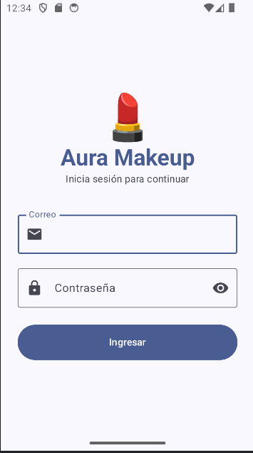
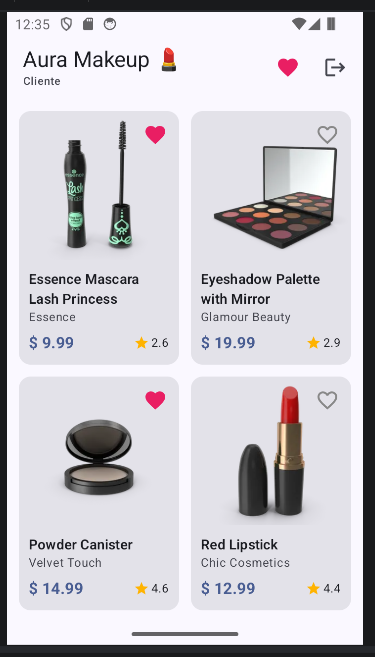
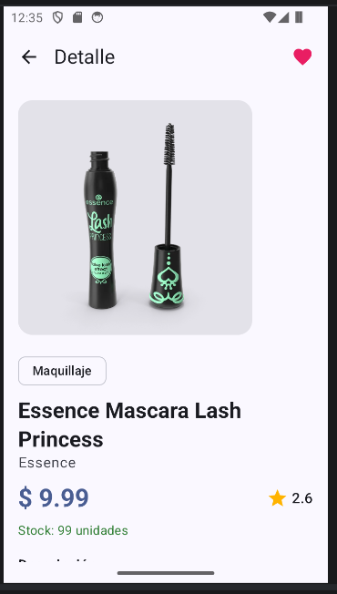
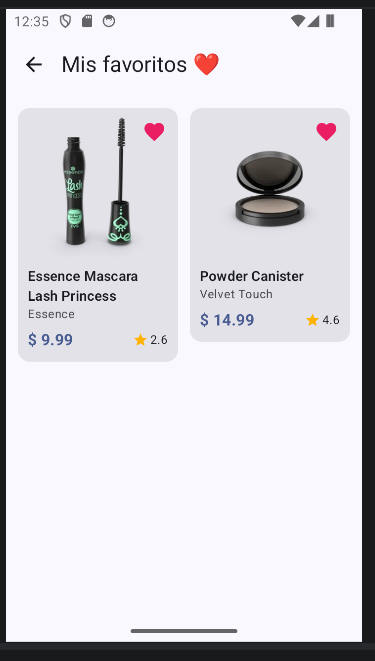
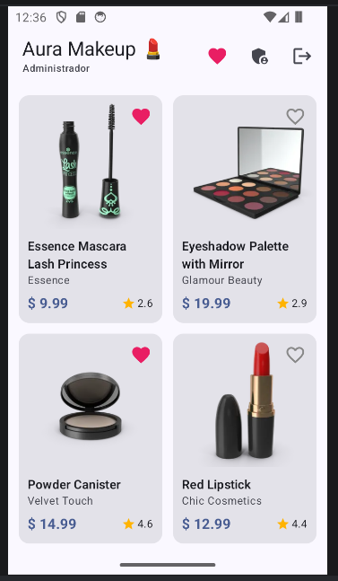
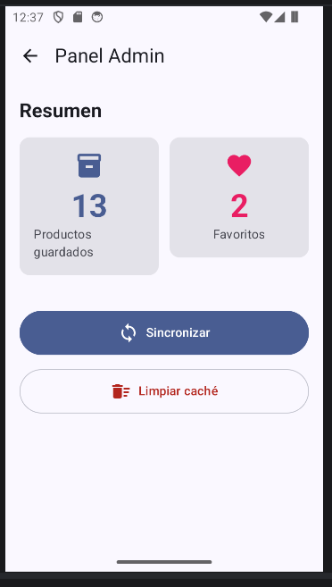

# Aura Makeup

**Laboratorio 11-12 - Programación en Móviles - TECSUP**

**Integrante:** Magaly Rosales Porras

## Tema y variante

| Tema | API | Variante |
|---|---|---|
| Productos (belleza) | [DummyJSON](https://dummyjson.com) | Categorías `beauty`, `skin-care`, `fragrances` |

| Uso | Endpoint |
|---|---|
| Lista | `GET products/category/{slug}` |
| Detalle | `GET products/{id}` |

## Cómo compilar

1. Clonar el repositorio y abrir la carpeta `semana12` en Android Studio.
2. Crear un proyecto en [Firebase](https://console.firebase.google.com) y registrar la app Android con el paquete `com.tecsup.auramakeup`.
3. Descargar `google-services.json` y colocarlo en `semana12/app/`.
4. Sync Gradle y ejecutar.

## Usuarios de prueba

1. **Authentication > Método de acceso:** habilitar *Correo electrónico/contraseña*.
2. **Authentication > Usuarios:** crear dos usuarios (uno admin y uno usuario).
3. **Firestore:** crear la colección `usuarios` con un documento por usuario. El **ID del documento es el UID** del usuario.

| Campo | Tipo | Valor |
|---|---|---|
| `rol` | string | `admin` o `usuario` |
| `nombre` | string | nombre del usuario |

## Capturas

| Login | Lista | Detalle |
|---|---|---|
|  |  |  |

| Favoritos | Panel Admin | Notificación |
|---|---|---|
|  |  |  |
