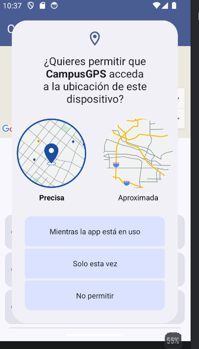
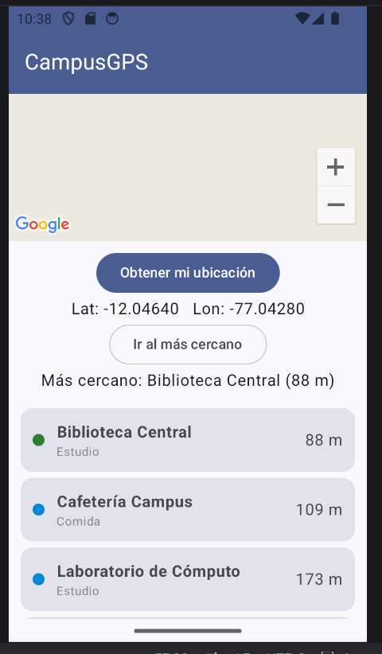
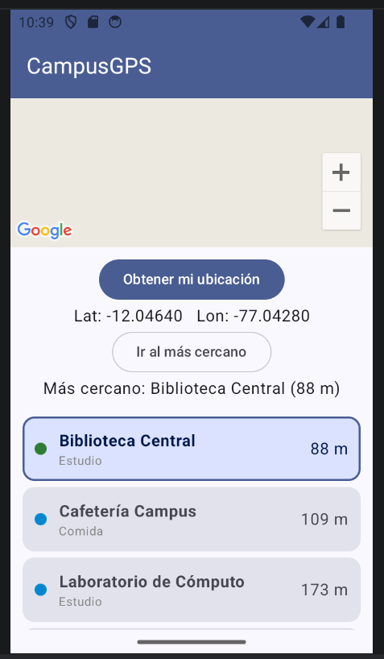
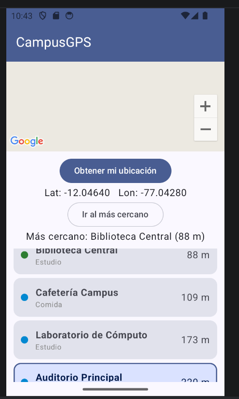
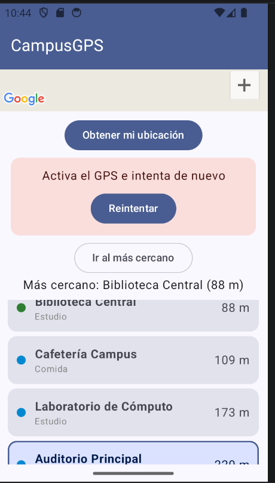

# CampusGPS


**Estudiante:** Magaly Rosales Porras 

· Programación en Móviles 

· TECSUP 

· Docente: Juan León S.

## Estructura de paquetes
```
com.rosales.campusgps/
├── MainActivity.kt
├── model/      Modelos.kt (Posicion, Lugar, LugarConDistancia, UbicacionUi, TipoError)
├── data/       UbicacionRepository, UbicacionRepositoryGoogle, LugaresRepository, LugaresRepositoryLocal
├── util/       Distancia.kt, Formato.kt
├── viewmodel/  MapaViewModel, CampusViewModelFactory
└── ui/         PantallaMapa, MapaUbicacion, ListaLugares, MensajeError, theme/
```

## Arquitectura MVVM + Repository
```
View (PantallaMapa)
   | evento: pulsar el botón        ^ collectAsState()
   v                                |
ViewModel (MapaViewModel) --- StateFlow --->
   | llama a las interfaces
   v
UbicacionRepository ---> UbicacionRepositoryGoogle (FusedLocationProviderClient)
LugaresRepository    ---> LugaresRepositoryLocal (5 lugares fijos)
```

## Capturas
| Permiso | Mi ubicación | Marcadores | Lista ordenada | Error |
|---|---|---|---|---|
|  |  |  |  |  |


## Para pensar

1. **¿Por qué FusedLocationProviderClient está en el Repository?**
   
- Porque necesita el Context de Android. Así el ViewModel solo pide la ubicación y es más fácil de probar.

2. **¿Diferencia entre el permiso y la clave de Maps?**
   
- El permiso lo da el usuario para saber dónde está el celular; sin él sale un error. La clave la da Google para mostrar el mapa; sin ella el mapa sale gris.

3. **¿Por qué la clave va en local.properties?**
   
- Porque ese archivo no se sube a GitHub. Si se sube por error, se borra la clave y se crea otra.

4. **¿Dónde se calcula la distancia?**
   
- En util, y la usa el ViewModel. No va en el Composable porque la pantalla solo muestra datos.

5. **¿Qué pasa si niega el permiso dos veces?**
   
- Android ya no pregunta más. La app no se cierra y muestra el botón Abrir ajustes para activarlo a mano.

