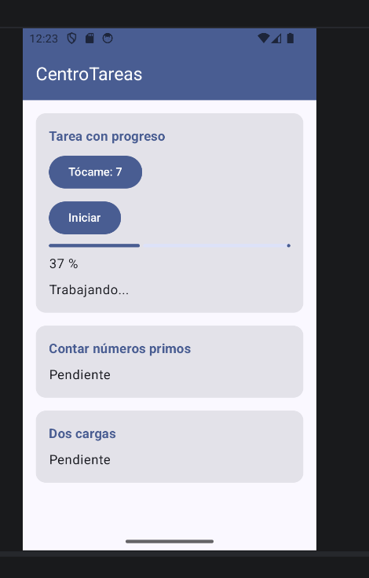
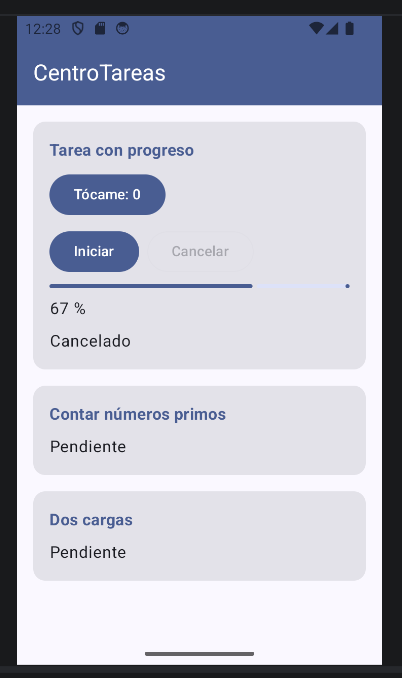
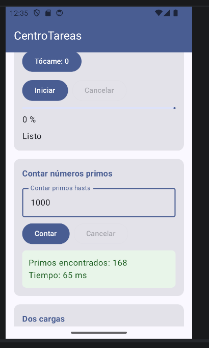
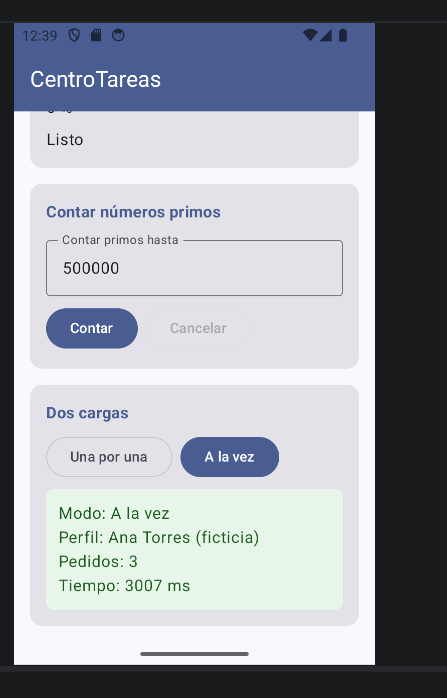
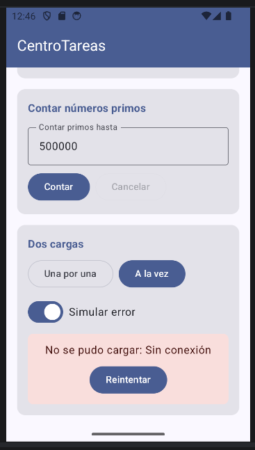

# CentroTareas

**Estudiante:** Magaly Rosales Porras · Programación en Móviles · TECSUP · Docente: Juan León S.

## Estructura de paquetes
```
com.rosales.centrotareas/
├── MainActivity.kt
├── model/      Estados.kt (PrimosUi, CargaUi)
├── data/       TareasRepository, TareasRepositoryLocal
├── viewmodel/  TareasViewModel, TareasViewModelFactory
└── ui/         PantallaTareas, theme/
```

## Arquitectura MVVM + Repository
```
View (PantallaTareas)
   | eventos: botones              ^ collectAsState()
   v                               |
ViewModel (TareasViewModel) --- StateFlow --->
   | viewModelScope.launch { ... }
   v
TareasRepository (interface) ---> TareasRepositoryLocal
                                   (cargas simuladas y contar primos)
```

## Observación del Paso 1
Al tocar **Tarea larga (MAL)** la pantalla se congela 4 segundos: el botón Tócame no suma y nada responde.
No se ve "Trabajando..." porque `Thread.sleep` bloquea el hilo principal, que es el que dibuja la pantalla; cuando se libera, el mensaje ya cambió a "Terminó".
Si la espera fuera de 10 segundos, Android mostraría el aviso **"La app no responde"** (ANR) para cerrarla o esperar.

## Capturas
| Tarea con progreso | Cancelada | Primos | Una por una vs a la vez | Error |
|---|---|---|---|---|
|  |  |  |  |  |

## Para pensar
1. **¿Por qué no se veía Trabajando... en el Paso 1?**

Porque Thread.sleep dejó trabado el hilo principal, que es el que dibuja la pantalla. Mientras esperaba no pudo mostrar nada, y cuando se liberó el texto ya había cambiado a "Terminó".

2. **¿Diferencia entre Thread.sleep y delay?**

Thread.sleep detiene todo el hilo y nada más puede funcionar. delay solo pausa la corrutina y deja el hilo libre para que la pantalla siga respondiendo. Además, delay se puede cancelar.

3. **¿Por qué Dispatchers.Default para los primos y Dispatchers.IO para la red?**

Default es para cálculos que hacen trabajar mucho al procesador, como contar primos. IO es para cuando se espera una respuesta de internet o de un archivo, donde casi todo el tiempo se está esperando.

4. **¿Qué pasa si el usuario cierra la pantalla?**

viewModelScope cancela las tareas cuando el ViewModel se destruye, así no se quedan trabajando sin sentido. Si solo se gira la pantalla, el ViewModel sigue vivo y la tarea continúa.

5. **¿Por qué async tarda 3 s y no 5 s? ¿Y si una falla?**

Porque las dos cargas se hacen al mismo tiempo, y solo se espera a la más lenta, que tarda 3 segundos. Si una falla, la otra también se detiene y la app muestra el mensaje de error con el botón Reintentar.