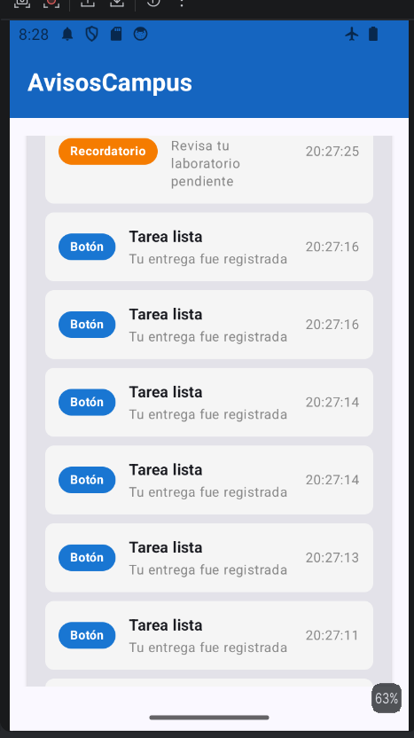
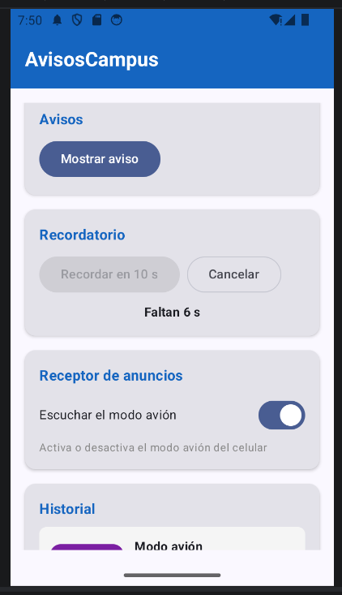
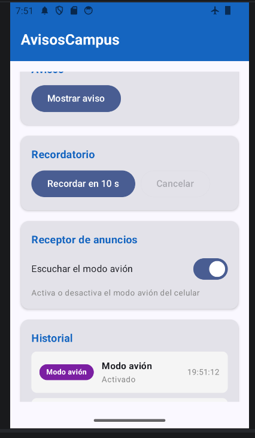
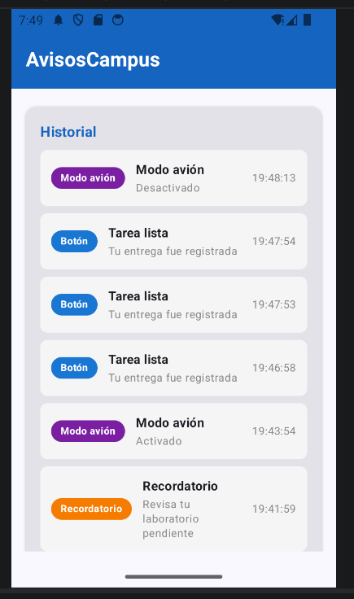
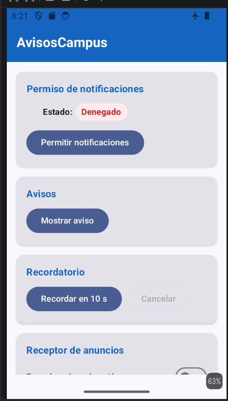

# AvisosCampus

**Laboratorio GLAB-S15 · Notificaciones en Android**
Curso: Programación en Móviles · TECSUP · Docente: Juan León S.
Alumna: Magaly Liz Rosales Porras

## Descripción

AvisosCampus es una app Android que muestra notificaciones locales y escucha eventos del sistema:

- **Mostrar aviso:** muestra al instante la notificación *Tarea lista*.
- **Recordatorio:** programa un aviso que llega a los 10 segundos, con cuenta regresiva y opción de cancelar (corrutinas).
- **Receptor de anuncios:** con un `BroadcastReceiver` avisa cuando se activa o desactiva el modo avión.
- **Historial:** guarda todos los avisos con su origen y hora, lo más reciente arriba.
- **Permiso denegado:** si el usuario niega el permiso, la app no se cierra, guarda el aviso en el historial y ofrece abrir los ajustes.

**Tecnología:** Kotlin · Jetpack Compose · Material 3 · MVVM + Repository · Coroutines · StateFlow / SharedFlow · NotificationCompat · BroadcastReceiver
**Requisito:** emulador o celular con Android 13+ (API 33) para probar el permiso.

## Estructura de paquetes

```
com.tecsup.avisoscampus/
├── AvisosApp.kt                  Application: crea el canal
├── MainActivity.kt
├── model/
│   └── Modelos.kt                Aviso, Origen, PermisoUi
├── data/
│   └── AvisosRepository.kt       interface + AvisosRepositoryMemoria
├── notificacion/
│   └── Notificador.kt            canal, permiso y mostrar
├── receiver/
│   ├── ModoAvionReceiver.kt      escucha ACTION_AIRPLANE_MODE_CHANGED
│   └── CargadorReceiver.kt       escucha POWER_CONNECTED / DISCONNECTED
├── viewmodel/
│   ├── AvisosViewModel.kt
│   └── AvisosViewModelFactory.kt
└── ui/
    ├── PantallaAvisos.kt
    ├── HistorialAvisos.kt
    └── theme/
```

## Arquitectura MVVM + Repository

```
 View (PantallaAvisos)
   │  eventos: botones, switch          ▲ collectAsState()
   ▼                                    │
 ViewModel (AvisosViewModel) ── StateFlow (avisos, permiso, faltan, escuchandoAvion, escuchandoCargador, mensaje)
   │  registra el aviso                 │ emite: eventos (SharedFlow<Aviso>)
   ▼                                    ▼
 AvisosRepository (interface)        View recibe el evento y llama a
   └─ AvisosRepositoryMemoria        Notificador.mostrar(context, aviso)
```

| Capa | Conoce a | NO hace |
|---|---|---|
| View (`ui/`) | Su ViewModel y el Notificador | Decidir qué se avisa ni guardar el historial |
| ViewModel | Solo la interface del Repository | Usar `Context`, `NotificationManager` ni `BroadcastReceiver` |
| Repository | Nada de la UI | Usar `Context` |
| Notificador | El sistema (canal, NotificationManager) | Guardar estado de la app |

## Capturas

| Notificación en el panel | Recordatorio | Modo avión |
|---|---|---|
|  |  |  |

| Historial | Permiso denegado |
|---|---|
|  |  |

## Pruebas de aceptación (emulador API 33+)

| Prueba | Resultado esperado | OK |
|---|---|---|
| Ajustes → Apps → AvisosCampus → Notificaciones | Existe el canal *Avisos* | Sí |
| Pulsar *Permitir notificaciones* | Aparece el cuadro de Android y la etiqueta cambia | Sí |
| Pulsar *Mostrar aviso* | Aparece la notificación *Tarea lista* | Sí |
| Pulsar *Mostrar aviso* dos veces | Aparecen dos notificaciones distintas | Sí |
| Tocar la notificación | Se abre la app y la notificación desaparece | Sí |
| *Recordar en 10 s* | Cuenta regresiva y aviso al llegar a 0 | Sí |
| Recordar y minimizar la app | El aviso llega igual | Sí |
| Recordar y cancelar | No llega ningún aviso | Sí |
| Switch activado y cambiar el modo avión | Aviso *Activado* y luego *Desactivado* | Sí |
| Switch desactivado y cambiar el modo avión | No hay aviso | Sí |
| Permiso denegado y *Mostrar aviso* | Mensaje de error, aviso en el historial y la app no se cierra | Sí |
| Rotar la pantalla durante el recordatorio | La cuenta regresiva continúa | Sí |
| Revisar el código | No hay `Context` en `viewmodel/` y todo receptor se quita en `onDispose` | Sí |

## Para pensar

**1. ¿Por qué una notificación necesita un canal y un permiso? ¿Qué pasa si falta cada uno?**
El canal (Android 8+) define la importancia y el permiso POST_NOTIFICATIONS (Android 13+) autoriza mostrarla; si falta cualquiera de los dos, la notificación no aparece.

**2. ¿Por qué el ViewModel emite un evento y no muestra la notificación él mismo?**
Porque mostrarla requiere `Context` y el ViewModel no debe tenerlo (evita fugas de memoria y permite probarlo sin Android), así que solo emite el evento y la pantalla llama al Notificador.

**3. ¿Qué pasa si usas el mismo id en dos notificaciones?**
La segunda reemplaza a la primera en el panel, por eso se usa `aviso.id`, que es único.

**4. ¿Por qué onReceive debe ser corto y por qué hay que quitar el receptor al salir?**
Corre en el hilo principal y si tarda congela la app (ANR); hay que quitarlo en `onDispose` para no filtrar memoria ni seguir recibiendo eventos.

**5. ¿En qué casos usarías una notificación local y en cuáles una push de Firebase?**
Local cuando el aviso nace en el propio celular (recordatorios, eventos del sistema); push cuando viene de un servidor (mensajes, anuncios del docente) y debe llegar aunque la app esté cerrada.

## Fase 2 · Mejoras con IA (rama mejora-ia-15)

En esta fase se integraron 3 mejoras avanzadas de notificaciones y eventos de sistema asistidas por IA.

### Resumen de Mejoras

| Mejora | Qué logra | Capas que cambian | Cómo probarla |
|---|---|---|---|
| Canal Urgentes | Notificación emergente (Heads-Up) con prioridad alta para recordatorios. | Model, Data, Notificación, ViewModel | Desinstalar app, reinstalar, programar recordatorio en 10 s y observar el cartel emergente arriba. |
| Texto completo con BigTextStyle | Permite expandir la notificación para leer mensajes largos de múltiples líneas. | Notificación, ViewModel | Enviar un recordatorio, abrir la cortina de notificaciones y deslizar la notificación hacia abajo. |
| Receptor del cargador | Notifica en tiempo real cuando el celular se conecta o desconecta de la corriente. | Receiver, Model, Notificación, ViewModel, UI | Activar Switch 'Escuchar el cargador', ir a Extended Controls -> Battery -> Charger connection (AC charger / None). |

### Captura adicional

| Receptor del cargador |
|---|
|  |
