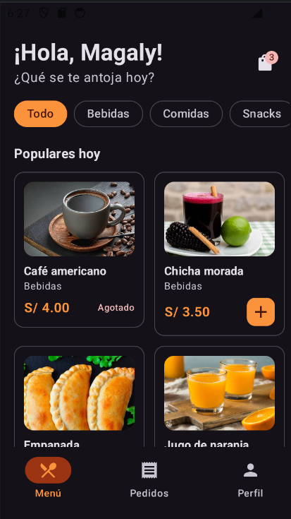
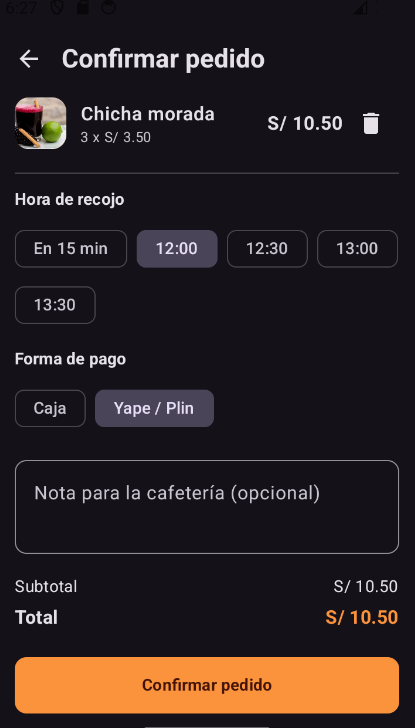
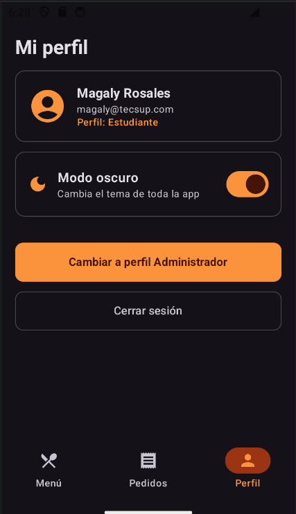
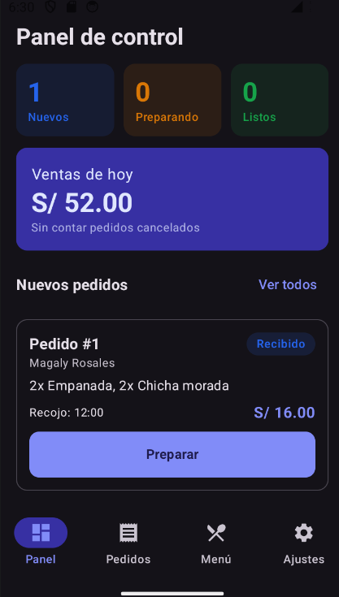
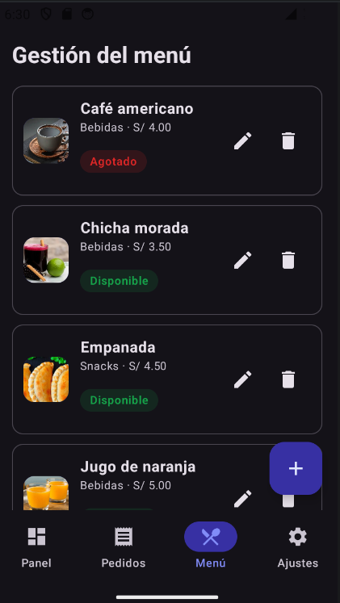
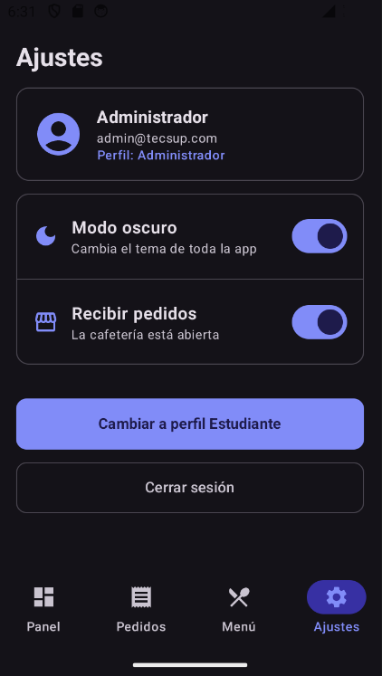

# CafeCampus 

App de pedidos para la cafetería del campus — Laboratorio 08 **MVVM + Room**

## Descripción

Dos perfiles conviven en el mismo dispositivo y comparten la misma base de datos Room:

- **Estudiante:** ve el menú, arma su pedido, lo confirma y sigue su estado en tiempo real.
- **Administrador:** ve el panel del día, atiende pedidos por estado y gestiona el menú.

### Credenciales de prueba

| Perfil | Correo | Clave |
|---|---|---|
| Estudiante | magaly@tecsup.com | 1234 |
| Administrador | admin@tecsup.com | admin |


## Arquitectura MVVM + Repository

```
VIEW (Composable)
   │ eventos (clics)        ▲ collectAsState()
   ▼                        │
VIEWMODEL (StateFlow)
   │ llama                  ▲ Flow / resultados
   ▼                        │
CafeRepository (interface)
   │ la implementa
   ▼
CafeRepositoryRoom ──► DAO ──► SQLite (cafecampus.db)

DataStore (preferencias) ──► ViewModel
```

**Regla de oro:** lectura que actualiza la pantalla → `Flow`; escritura o acción única → `suspend`.

## Estructura de paquetes

```
com.rosales.cafecampus
├── MainActivity.kt
├── CafeApp.kt
├── data
│   ├── local
│   │   ├── entity      Producto · Usuario · Pedido · DetallePedido
│   │   ├── dao         ProductoDao · UsuarioDao · PedidoDao
│   │   ├── relation    PedidoConDetalle
│   │   ├── CafeDatabase.kt
│   │   └── DatosIniciales.kt
│   ├── repository      CafeRepository (interface) · CafeRepositoryRoom
│   └── prefs           PreferenciasStore
├── model               Rol · EstadoPedido · ItemCarrito
├── viewmodel           CafeViewModelFactory · MenuViewModel · SesionViewModel
│                       PedidosClienteViewModel · PanelAdminViewModel
│                       PedidosAdminViewModel · MenuAdminViewModel
└── ui
    ├── theme           Color · Type · Theme
    ├── components      AppTopBar · CafeButton · CafeTextField · EstadoChip
    │                   ProductoCard · ProductoIcono · PedidoCard · StepperEstado
    ├── navigation      Rutas · NavCafe
    ├── cliente         Splash · Login · Menu · DetalleProducto
    │                   ConfirmarPedido · Seguimiento · MisPedidos
    └── admin           Panel · PedidosAdmin · DetallePedidoAdmin
                        MenuAdmin · FormularioProducto · Ajustes
```

## Capturas

| Estudiante | | |
|---|---|---|
|  |  |  |

| Administrador | | |
|---|---|---|
|  |  |  |
## Para pensar

**¿Por qué el Repository es una interface?** 

Porque los ViewModels dependen del contrato y no de Room, así se puede cambiar la fuente de datos sin tocar ViewModels ni pantallas.

**¿Por qué crearPedido es suspend y observarPedidosCliente es Flow?** 

CrearPedido es una acción única que escribe y termina, observarPedidosCliente debe avisar a la pantalla cada vez que los datos cambian.

**¿Qué pasaría si dos perfiles usaran bases distintas?** 

El admin no vería los pedidos del estudiante ni el estudiante los cambios de estado: se rompería la sincronización.

**¿Qué cambiaría si los datos viven en un servidor?** 

Solo se crea otra implementación de CafeRepository por ejemplo con Retrofit y se cambia en CafeApp, ViewModels y pantallas quedan igual.

