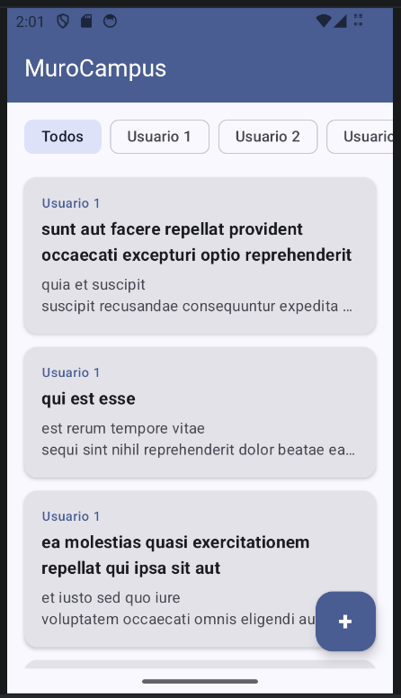
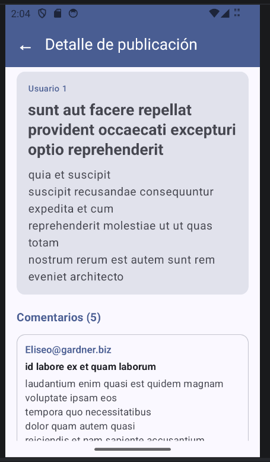
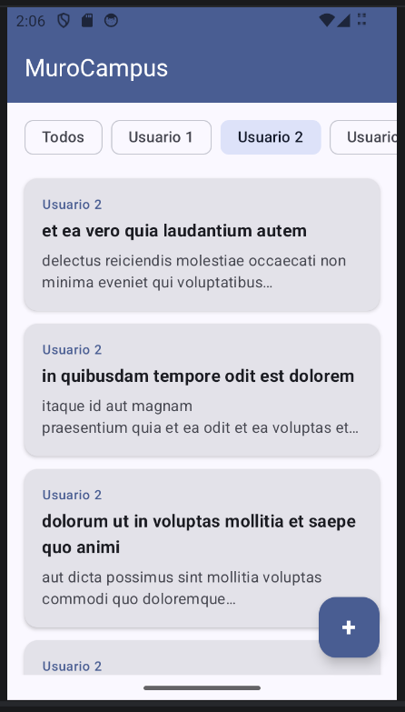
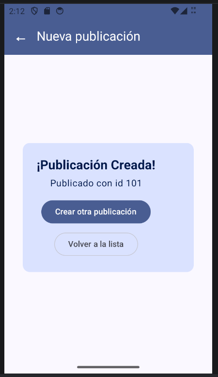
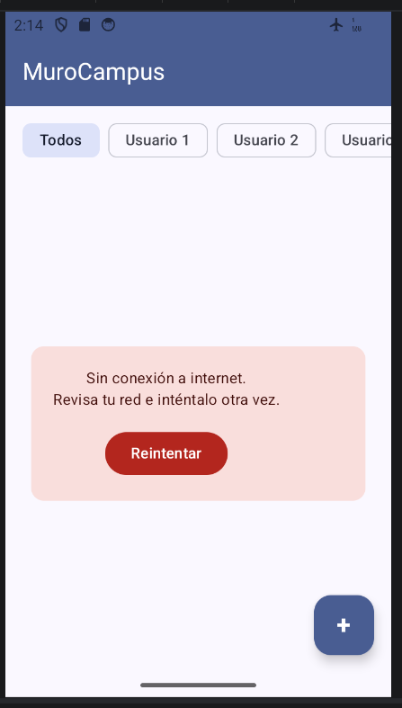

# MuroCampus 

App Android desarrollada con **Kotlin**, **Jetpack Compose** y arquitectura **MVVM + Repository**. 

Permite consultar, filtrar, ver el detalle con comentarios y simular el envío de publicaciones conectándose a la API REST de **JSONPlaceholder**.

---

## Árbol de Paquetes

```
com.tecsup.murocampus/
├── MainActivity.kt
├── model/
│   └── Modelos.kt
├── data/
│   ├── remote/
│   │   ├── PostApi.kt
│   │   └── RetrofitClient.kt
│   └── PostRepository.kt
├── viewmodel/
│   ├── UiState.kt
│   ├── PostsViewModel.kt
│   └── PostsViewModelFactory.kt
└── ui/
    ├── Componentes.kt
    ├── PantallaLista.kt
    ├── PantallaDetalle.kt
    ├── PantallaCrear.kt
    └── theme/
```

---

##  Diagrama de Arquitectura MVVM + Repository

```
+-----------------------------------------------------------+
|                          VIEW                             |
|    (PantallaLista, PantallaDetalle, PantallaCrear)        |
|                  UI basada en Jetpack Compose             |
+-----------------------------+-----------------------------+
                              |
                              | Observa StateFlow<UiState>
                              v
+-----------------------------------------------------------+
|                        VIEWMODEL                          |
|                     (PostsViewModel)                      |
|          Gestiona estados (Cargando, Exito, Error)        |
+-----------------------------+-----------------------------+
                              |
                              | Llama a suspend fun -> Result<T>
                              v
+-----------------------------------------------------------+
|                        REPOSITORY                         |
|                   (PostRepositoryRemote)                  |
|    Maneja excepciones y retorna Result<T> (con try/catch) |
+-----------------------------+-----------------------------+
                              |
                              | Invoca suspend fun
                              v
+-----------------------------------------------------------+
|                        REMOTE API                         |
|                    (PostApi con Retrofit)                 |
|               Peticiones HTTP mediante OkHttp             |
+-----------------------------+-----------------------------+
                              |
                              | JSON HTTP / REST
                              v
+-----------------------------------------------------------+
|                     JSONPlaceholder API                   |
|            https://jsonplaceholder.typicode.com           |
+-----------------------------------------------------------+
```

---

## Capturas de Pantalla
| Lista de Publicaciones | Detalle y Comentarios | Filtro por Usuario |
| :---: | :---: | :---: |
|  |  |  |

| Crear Publicación | Error de Conexión |
| :---: | :---: |
|  |  |
---

## Preguntas

### 1. ¿Qué diferencia hay entre GET y POST? ¿Por qué crear lleva @Body y porUsuario lleva @Query?
GET lee datos sin modificar nada y POST envía datos para crear un recurso; `crear` lleva `@Body` porque el JSON viaja en el cuerpo de la petición, y `porUsuario` lleva `@Query` porque el filtro va en la URL (`?userId=2`).

### 2. ¿Por qué la ruta es "posts" y no "/posts"?
Porque la barra inicial reemplazaría el camino de la URL base; sin ella, Retrofit la concatena correctamente a `https://jsonplaceholder.typicode.com/`.

### 3. ¿Por qué el Repository devuelve Result en vez de dejar que la excepción llegue al ViewModel?
Porque convierte las excepciones en `Result.failure`, así el ViewModel no maneja errores de red ni conoce Retrofit.

### 4. ¿Qué pasa si olvidas el permiso INTERNET? ¿Y si olvidas ignoreUnknownKeys y el servidor agrega un campo nuevo?
Sin el permiso la app compila pero nunca se conecta (`UnknownHostException`); sin `ignoreUnknownKeys` un campo nuevo del servidor rompe el parseo (`SerializationException`).

### 5. ¿Por qué la pantalla de lista usa un when sobre UiState y no un if con tres variables?
Porque los estados son excluyentes y el compilador exige cubrirlos todos, mientras que con tres variables podrían contradecirse.

### 6. JSONPlaceholder no guarda los POST. ¿Cómo cambiaría tu app si usaras un servicio real?
Tras el POST exitoso se recargaría la lista para mostrar la nueva publicación, y se podría guardar en Room como caché.